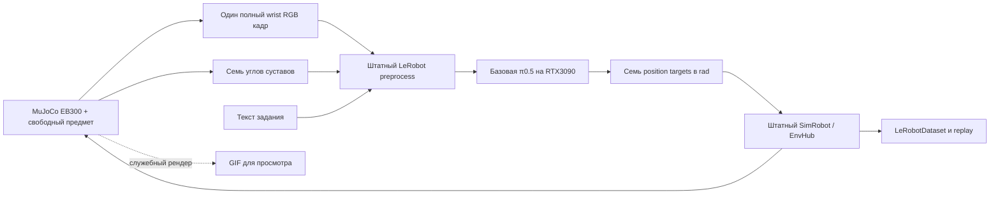

# EB300: среда, запись, воспроизведение, вход π0.5 и GIF

Выполнен [отдельно разрешённый владельцем scope](2026-11-17-eb300-envhub-adaptation.md): полная EB300+подвижный EBG20 подключена к штатному LeRobot EnvHub/SimRobot. Записан и воспроизведён диагностический episode. π0.5 получила **полный кадр нашей wrist-камеры, состояние7и текст**, выдала7действий и выполнила по3bounded sim steps в двух режимах. Это принятие интерфейса; **самостоятельный поиск/подбор карандаша и обучение grasp ещё не выполнены**.

## Что теперь открывать

- Runtime copy: `E:\RoboHand\LATEST\SIMULATION\EB300-ENVHUB`. Внутри README, `envhub/` с code/config/private meshes, server YAML и `SHOWCASE/`.
- [GIF1280×720,8секунд](<E:/RoboHand/LATEST/SIMULATION/EB300-ENVHUB/SHOWCASE/EB300-workcell.gif>) — стенд, движения руки/губок, полный wrist inset. Подпись внутри честно сообщает, что это заданные движения. Карандаш лежит на столе. [Постер](<E:/RoboHand/LATEST/SIMULATION/EB300-ENVHUB/SHOWCASE/EB300-workcell-poster.png>), [отдельный wrist-view GIF](<E:/RoboHand/LATEST/SIMULATION/EB300-ENVHUB/SHOWCASE/EB300-wrist-view.gif>).
- CAD остаётся `E:\RoboHand\LATEST\CAD\EB300.a3d`, SHA256 `3b919e9642686f2194ca007484ad860229b4fccadf0ea7517d40e6c2383254db`. Native assembly не перезаписывалась.
- [Adapter и команды](../../integrations/lerobot_envhub/README.md), [model data](../cad-reviews/2026-11-17-eb300-envhub/agent-report.md), [числовая сводка](../../evidence/2026-11-17-eb300-envhub.json).

## Реальный pipeline

Служебный общий вид не возвращается в policy. Новый motor controller, IK, teleoperator, UI или framework не создан. LeRobot core/model architecture не менялись. Использованы pins `lerobot@7910c20a75834ad3fa6a9792df4d44a614d1bba6`, reference EnvHub `e68145d8bd793c27fa2c13e31369a616895c5acb`, MuJoCo4.0.1, Gymnasium1.4.0 и NumPy2.2.6.

## Физическая сцена и контракт

Из принятой R8/held-tool scene удалён fixed rod и старые неподвижные gripper geoms. R2 gripper перенесён через проверенный canonical→wrist transform. Из wrist mass budget выделена масса подвижных групп с положительными inertia; двойной учёт исключён. Стол, клавиатура, монитор, PC, телефон и выбранное крепление `h120_b0_s-160_a20` сохранены.

Controlled state/action: J1…J6 и MG995, все7в rad. Rack slides, passive key_A и free pencil не являются действиями. Нельзя подменять этот contract action7от LIBERO. Полный reset qpos17/ctrl7/act7 лежит в стандартном keyframe и JSON; feedback и targets различаются под gravity. Одна камера640×360RGB,25Hz simulated clock,20steps×2ms на команду. Входное зрение не содержит object pose.

CAD-агент проверил10sim seconds no-action hold с every-step maxima: no warnings/resets, max angle drift≈6,077e−5rad, equality residual≈0,461µm, pencil–desktop penetration≈54,825µm, иных контактов нет. В4gripper poses с parent filter disabled нет контактов новых групп с wrist/phone/arm. Это не полная карта безопасного workspace и не реальная калибровка. Исходные omitted rack attachment, servo dynamics/friction и R2 release-impact gate остаются открытыми.

## Проверки interface и данных

Шесть проверок проходят в Linux и Windows: shapes/units/clock, NaN/Inf/неверный размер без продвижения физики, deterministic reset, завершение эпизода, отсутствие ложного lift success без контакта, запрет render/step до reset. Policy observation имеет ровно один camera key; `render("overview")` через environment запрещён.

Штатными LeRobotDataset API записан image-backed dataset: **1episode,50frames,25fps, action/state7, wrist360×640×3**. Повтор через SimRobot дал max joint error0rad; timestamp max error5,72e−8s. Все50изображений меняются при заданном движении. Сохранение, чтение и повтор выполнены; это diagnostic motion, не50успешных grasp demonstrations. `lerobot-record` с настоящим teleoperator пока не проверен, streaming video не проверялось. Stock decoder fallback PyAV не подменяется утверждением о рабочем TorchCodec FFmpeg.

## Скорость и размещение runtime

| Режим штатного replay CLI | Результат50ticks |
|---|---|
| WSL, всё в одном процессе, тени включены |5,40Hz wall time, при25Hz simulated clock; все49judged ticks вышли за40ms |
| Windows EnvHub server → WSL SimRobot, полный raw RGB, raster shadows выключены |24,86Hz wall time;1/49judged ticks выше40ms, mean work25,1ms, worst43,8ms |

Physics cost около1ms/control step; bottleneck был в shadow rendering/readback WSL, не в MuJoCo dynamics. Проверены стандартные EGL/GLFW и render flags, без изменения geometry/camera/frame. WSL EGL renderer выбран через документированный `MESA_D3D12_DEFAULT_ADAPTER_NAME=NVIDIA`: строка GL стала `D3D12 (NVIDIA GeForce RTX3090)`. [Mesa D3D12](https://docs.mesa3d.org/drivers/d3d12.html), [Microsoft WSLg GPU selection](https://github.com/microsoft/wslg/wiki/GPU-selection-in-WSLg/76d52924ab9f63773d12cb679f571da8fbd37fdf). Это не ускорило его до25Hz.

Переиспользован официальный torch-free server install из pinned `docker/sim/requirements.txt` + `lerobot --no-deps`. В Windows server Torch действительно не установлен. Native Windows OpenGL выбрал Intel UHD750; inference остаётся на RTX3090. Такое разделение не требует ещё одного компьютера. Server и client используют тот же code/scene/contract, network ограничена виртуальным Windows/WSL adapter. Полный raw frame передаётся без JPEG/ROI. `render_shadows=false` — явный optional visual setting; default и GIF оставляют тени. Профиль и режим сохраняются с dataset.

Это короткие прогоны, **не hard-real-time guarantee**. У свежего model chunk отдельная latency;25Hz replay не является25fresh π0.5 forward/s. Temporary server после проверки остановлен, persistent service/firewall/driver changes не выполнялись. Ready config/venvs сохранены для следующего запуска.

## π0.5 на нашей сцене

Использованы stock `make_policy`, dataset-derived features, pre/postprocessors, `predict_action` и SimRobot, unchanged base checkpoint `lerobot/pi05_base@22c30e5b34f9e7ab738b1b34fc2fc5ecfe2d28f0`. Локальный owner tokenizer, один настоящий текущий full wrist image, state7, текст `Pick up the pencil.`; output7. Нет искусственных duplicate cameras или object-pose feature.

| Проверка | WSL local env | Windows-served env + WSL CUDA policy |
|---|---:|---:|
| Finite action и state после исполнения |3/3 |3/3 |
| First fresh chunk |0,642s |0,913s |
| Два следующих fresh chunks |0,399/0,468s |0,407/0,457s |
| Peak allocated |9 437 343 232bytes |9 437 343 232bytes |
| Успешный pickup |нет |нет |

Каждый вызов принудительно reset cached action chunk; эти времена не являются временем извлечения очередного готового action из очереди. Нормализация взята из50frame diagnostic dataset; несколько arm actions там постоянны. Поэтому почти постоянные выходы по этим осям ожидаемы и **не доказывают умение видеть/брать карандаш**. Здесь не выполнялось EB300 fine-tuning, а previous reference LoRA adapter не объявляется её skill.

## Сохранение и следующий этап

Private full run: `E:\RoboHand\runs\2026-11-17-eb300-envhub`. Git хранит разрешённый adapter/tests/standard model data, отчёты и числовую evidence. CAD/STL/dataset/GIF/raw SDK traces/tokenizer/weights не публикуются. Runtime copy отдельно от accepted CAD. Recovery packet: `E:\RoboHand\releases\EB300-ENVHUB-2026-11-17\EB300-ENVHUB-2026-11-17.zip`, зеркало `D:\RoboHand-Backups\EB300-ENVHUB-2026-11-17.zip`; manifest/CRC/SHA фиксируются в receipt. Полные base weights и venv в ZIP не дублируются; source pins/freezes и предыдущий tokenizer/LoRA packet сохранены.

Дальше нужен готовый способ получения **успешных demonstrations** free-pencil approach→contact→lift→hold. В pinned LeRobot нет готового seven-joint EB300 teleoperator; другую leader arm/keyboard mapping нельзя назвать совместимыми без проверки. Сначала reuse-first выбор готового варианта и его minimal smoke; затем pilot10–20качественных demonstrations и официальный LoRA recipe, независимые test positions. Не обучать grasp на interface smoke. Keyboard/слово и Codex coordinator идут после принятого motor skill.

От владельца сейчас не нужны новые покупки или переделка CAD. На этапе сбора demonstrations понадобится выбрать способ показа; calibration реальной камеры/приводов остаётся отдельной от виртуального интерфейса.

[Индекс](../index.md) · [план](<../../../../../../_ПЛАНЫ_/embedded-robotics-market-research/research/projects/robohand/plans/2026-11-17-foundation-lora.md>).
