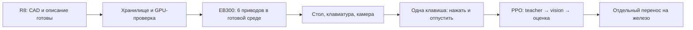

# EB300 на этом ПК: что готово и что делаем дальше

У нас есть проверенная **виртуальная конструкция EB300 версии R8**. Её можно открыть в КОМПАСе и в установленном симуляторе MuJoCo. Следующая цель — заставить эту модель управляемо нажать и отпустить одну виртуальную клавишу. Обучение начинается после проверки такой среды.

**Уточнение 15.11:** рабочая сборка выделена в `E:\RoboHand\LATEST\CAD\EB300.a3d`, рядом в LATEST есть ярлык MuJoCo. [URDF и сцена подробно, на примере нашей руки](urdf-mujoco-explained.md). [Docker уже перенесён на E: и проверен; CUDA compute test прошёл](research/2026-11-15-runtime-gpu-smoke.md). Штатная установка pinned typing runtime запущена; physics/RTX smoke ещё впереди. До обучения добавлена ручная проверка движения; пульт для первого этапа не требуется.

## Что мы сделали со сборкой

Взяли переданную сборку из STL и сохранили исходники отдельно. В рабочей копии восстановили полное запястье, исправили взаимное положение жёстких частей и труб, задали шесть вращательных осей и сопряжения. Подвижность проверили изменением углов с последующим сохранением, закрытием и повторным открытием файлов.

В текущей R8 одна корневая сборка с **семью физическими узлами**: основание, плечо, верхнее звено, предплечье, две части запястья и инструментальный узел. Три группы оформлены штатными подсборками КОМПАСа. Так дерево читается по конструкции; шесть суставов сохраняют движение. Сливать всё в одно неподвижное тело для робота не требуется.

На конце находятся обычный захват EBG20, кронштейн и Redmi 8A. По решению владельца стержень и его держатель удалены. Точку для нажатия выбрали **на кромке штатной губки**. Дополнительный концевик касания не добавляли. Вспомогательные открытые поверхности скрыли; треугольники на STL — способ представления поверхности, а не отдельные детали.

Кроме CAD подготовлены стандартные описания робота:

| Файл / программа | Для чего нужен |
|---|---|
| A3D в КОМПАСе | Конструкция, положение деталей, сопряжения, кронштейн и телефон |
| URDF | Скелет робота: звенья, оси, системы координат, геометрия столкновений и параметры |
| MJCF в MuJoCo | Импортированная сцена для просмотра и проверки геометрии/физических данных |
| Среда NVIDIA typing — следующий этап | Клавиатура, управление приводами, наблюдения, условия успеха и обучение |

URDF подготовлен как стандартные данные по проверенной CAD-геометрии. Обещания автоматического экспорта всех сопряжений КОМПАСа в URDF здесь нет.

## Почему считаем этап готовым

Проверки записаны в [отчёте R8](cad-reviews/2026-11-15-logical-r8/root-review.md) и [независимой приёмке](cad-reviews/2026-11-15-logical-r8/root-acceptance.json):

- Сборка повторно открывается; сопряжения корректны. Каждую из шести осей проверили в небольшом диапазоне ±5°: всего 48 обновлений CAD.
- Сопоставили CAD и описание робота в 49 сохранённых состояниях, включая 25 различных заданных конфигураций. Максимальное расхождение положения геометрии меньше 0,000001 м. Это точность согласования двух цифровых представлений; механическую точность реальной руки она не измеряет.
- URDF прошёл проверку и сборку ROS 2. MuJoCo загрузил модель; номинальные массы/инерции допустимы, пассивная численная интеграция не расходится.
- Найдены и сохранены все 24 native-зависимости сборки. Архивы на E: и D: проверены по содержимому и SHA256.

**Готовность относится к конструкции и описанию робота.** В текущей сцене нет приводов, управляющей политики и клавиатуры; гравитация отключена для осмотра. Небольшие повороты ±5° не подтверждают весь рабочий диапазон. Раскрытие захвата пока зафиксировано. Массы, инерции и параметры приводов в основном оценочные; известная масса Redmi — 188 г. Реальные нули, люфты, усилия и камера ещё требуют измерений.

Камера уже привязана к запястью. По текущему номинальному ракурсу точную выбранную кромку частично закрывает сама губка. На клавиатурной сцене проверим обзор клавиш и при необходимости поправим кронштейн/позу. Это известная задача следующего этапа.

## Где лежит финальная версия

Открывать в КОМПАСе:

```text
E:\RoboHand\LATEST\CAD\EB300.a3d
```

Постоянный указатель — `E:\RoboHand\CURRENT.json`. Все пути и восстановление собраны в [«Актуальные файлы R8»](latest-artifacts.md). В `CAD\components` лежат 23 зависимости, включая нужную подсборку `EB300-R8-upper-rigid-smoke.a3d`. Старые `outputs` сохранены для истории. [Проверка отдельного комплекта](cad-reviews/2026-11-15-latest-package/cad-agent-report.md).

Один A3D не заменяет весь комплект. Рабочий CAD сохранён в `E:\RoboHand\releases\EB300-LATEST-R8-2026-11-15\EB300-LATEST-R8-2026-11-15.zip` и на D:. Прежний полный архив R8 с симуляционными meshes, а также R7S сохранены отдельно. Новую геометрическую ревизию делаем в новой копии.

## Как посмотреть прямо сейчас

Ничего дополнительно устанавливать для первого просмотра не нужно. Дважды нажми `E:\RoboHand\LATEST\ПОСМОТРЕТЬ-В-MuJoCo.lnk`. Для осмотра поз — пауза `Space`, панель Joint `Alt+J`; это изменение координат в небольшом диапазоне, ещё не управление приводами. Либо открой PowerShell, вставь команду и нажми Enter:

```powershell
& 'E:\RoboHand\tools\cad-validation-2026-11-14\.venv\Scripts\python.exe' -m mujoco.viewer --mjcf 'D:\ПРОЕКТЫ\_ЛИЧНОЕ_\ВОПЛОЩЕННЫЙ_ЭЙАЙ\РОБОРУКА\RoboHand\RoboHand.Simulator\robohand_ws\src\robohand_description\urdf\eb300_jaw_typing_r8.validation.xml'
```

Откроется штатное окно MuJoCo с нашей рукой. Осмотри общую форму, запястье, обычные губки и телефон. Для редактирования конструкции используй A3D в КОМПАСе. В этом просмотрщике ещё нет текстовых команд, голоса и самостоятельной печати. [Официальная документация viewer](https://mujoco.readthedocs.io/en/stable/python.html#interactive-viewer).

## Что установлено на этом ПК

Проверка 15.11: Windows 10 Enterprise N, RTX 3090 с 24 ГБ VRAM, драйвер 580.97. Работают WSL2 Ubuntu 22.04, WSLg и Docker Desktop 28.3.2; GPU видна из WSL. MuJoCo 4.0.1 установлен в указанном Python-окружении. Видимость GPU из WSL ещё не доказывает запуск выбранного NVIDIA-рецепта.

Docker теперь хранит VHDX в `E:\DockerDesktopWSL`; перенос владельцем проверен. В начале прохода свободно около 228 GiB на C: и 505 GiB на E:. Контейнер видит RTX 3090; официальный CUDA nbody выполнил вычисления. Запущен штатный `./so101 setup` по pinned upstream, большие слои загружаются на E:. Завершённая сборка, Newton rollout и RTX-камера пока не объявлены проверенными. [Уровни проверки и логи](research/2026-11-15-runtime-gpu-smoke.md).

## Следующие шаги и ближайшие сроки



| Когда | Что делаем | Чем подтверждаем завершение |
|---|---|---|
| Ближайший проход, 15–16 ноября | Перенос Docker и отдельный CUDA compute test пройдены; продолжаем setup и минимальный штатный запуск pinned NVIDIA-примера с двумя средами | Лог запуска физики и камер на RTX 3090; первый тест использует reference-робота |
| Неделя 16–22 ноября, после запуска reference | Готовые hooks EB300: шесть осей, приводы, губка, камера, стол и клавиатура; ручная проверка движения клавиатурой/пультом | Сцена сбрасывается и управляемо движется; корректны контакт, направления суставов, прекращение команды и изображение камеры |
| Неделя 23–29 ноября, если предыдущий этап пройден | Подводим губку к одной клавише, нажимаем, отпускаем, повторяем после сброса | Не менее 10 сбросов/попыток; считаем правильные, лишние и пропущенные нажатия |
| После рабочей задачи | Повторяем штатное обучение: сначала PPO-политика с состоянием среды, затем политика с изображением камеры на запястье; отдельно оцениваем | Сохранённые checkpoint/config/log, метрики на отдельных попытках и видео |

Даты — точки пересмотра. Скорость обучения и совместимость RTX 3090 устанавливаются запуском. Upstream проверял другую GPU; успешное обучение на нашей конфигурации заранее не объявляем.

Основа — [NVIDIA/so101-typing-task, commit 7aec2ed](https://github.com/NVIDIA/so101-typing-task/blob/7aec2ed26dce8c88ae007a2714680cce572e1466/docs/setup.md). Его путь — Linux/Docker, Isaac Lab, Newton и RTX-камера. Полный Isaac Sim GUI не является обязательной первой установкой для этого рецепта. SO-101 здесь служит проверкой готового сценария; наша платформа остаётся EB300. Веса готового typing-навыка в этом snapshot не опубликованы — обучение воспроизводим сами. В данном рецепте используется PPO; обучение ACT на демонстрациях относится к другому методу.

Замена пяти управляющих осей reference на шесть осей EB300 ещё требует проверки поддерживаемых точек подключения. Если штатной конфигурации недостаточно, сначала фиксируем конкретный gap и варианты. Новый исполняемый adapter без отдельного решения владельца не начинаем.

## Что требуется от владельца

**Сейчас:** открыть R8 и визуально сверить форму руки, губки и расположение телефона с задуманной конструкцией. Заново собирать CAD, покупать детали или приложение ToolBox для этого этапа не нужно.

**Для приближения сцены к столу:** по возможности сообщить модель клавиатуры и размеры рабочей поверхности. Это уточнения; первый запуск можно делать со стандартной клавиатурой upstream.

**Для последующего физического переноса:** маркировки двигателей/редукторов, передаточные отношения, настройки драйверов и измерения реальных ограничений. Базовый комплект, концевики и Redmi уже есть. Энкодеры и цепь остановки рассматриваем в отдельном аппаратном плане; закупка не блокирует виртуальную работу.

Голос и агент-планировщик добавляются после проверяемых навыков: например, планировщик выбирает действие «нажать клавишу», а обученная политика исполняет движение. На текущем этапе разработку ведём через Codex.

## В каком репозитории работаем

Текущие CAD-контракты, виртуальная сцена и настройки обучения — **RoboHand.Simulator**. Интеграция выполнения навыков — **RoboHand.Control**; прошивка — **RoboHand.Firmware**, одноосевой эталон — **RoboHand.OneMotor**. Общие исследования готовых agent/runtime решений — **ai-hardware-controller**. Глобальное досье хранит цели, решения, закупки и календарь со ссылками в эти независимые репозитории.

Публичный Git Simulator содержит описания, конфиги и отчёты; локальная геометрия восстанавливается из комплекта владельца. [Границы публикации и архив полных журналов](publication-scope.md). Git и два проверенных локальных архива вместе сохраняют результат.

[Индекс](index.md) · [Актуальные файлы](latest-artifacts.md).
