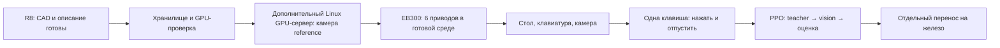

# EB300 на этом ПК: что готово и что делаем дальше

У нас есть проверенная **виртуальная конструкция EB300 версии R8** и отдельная действующая настольная сцена MuJoCo: обычная губка нажимает и отпускает тестовую A. В готовый NVIDIA recipe подключены шесть осей нашей руки, приводы и номинальная камера Redmi. Локальный фиксированный контакт и native PPO — отдельные проверки; обученного навыка печати пока нет.

**Уточнение15.11:** рабочая сборка выделена в `E:\RoboHand\LATEST\CAD\EB300.a3d`, рядом в LATEST есть ярлык MuJoCo. [URDF и сцена подробно](urdf-mujoco-explained.md). [Локальный Docker/CUDA/Newton/reference teacher проверен](research/2026-11-15-runtime-gpu-smoke.md); RTX-камера в WSL2 не стартовала. Вся разработка остаётся на этом ПК. Дополнительный native Linux GPU-сервер обслужен по разрешению владельца: driver/NVML согласованы, восстановление соседнего стенда проверено, GPU переданы руке. Тот же pinned runtime уже работает на сервере: [получены wrist-camera PNG, выполнены teacher/vision PPO и короткие evaluations](research/2026-11-15-native-linux-runtime.md). EB300 и обучение reference принимаются отдельно.

**Новое16.11:** владелец просмотрел CAD. [Рабочая сцена EB300](desktop-workcell-r1.md) имеет шесть штатных приводов, гравитацию, стол/периферию и camera image; фиксированное нажатие/отпускание A прошло10/10 повторов. Рука слева спереди, системный блок справа сзади. В [native адаптации](research/2026-11-16-eb300-native-training.md) исправлены контакты жёсткой оснастки и дублирование приводов; пройдены100шагов удержания, camera/reset, минимальные teacher/vision PPO, evaluation и USD/MP4 replay по [разрешённому объёму](research/2026-11-16-eb300-training-adaptation.md). В ограниченных evaluations0набранных символов — готовой печати пока нет. Предыдущая inspection scene остаётся отдельным файлом для осмотра.

## На каком этапе остановились

| Этап | Состояние на 16.11 |
|---|---|
| Конструкция EB300 R8 и описание шести суставов | Подготовлены и проверены; дальнейшие рабочие диапазоны, динамика и реальная калибровка ещё впереди |
| Docker на E:, вычисления RTX 3090, физика Newton | Проверки пройдены |
| Минимальное обучение reference NVIDIA | На native Linux выполнены по два PPO-обновления teacher и vision, сохранены checkpoints/sidecars; обе короткие evaluations завершились штатно. Навык печати ещё не обучен |
| RTX-камера выбранного Linux/Docker recipe | На native Linux получены и просмотрены два wrist PNG 160×120; camera smoke прошёл. Локальный WSL2 Vulkan error остаётся отдельным ограничением |
| EB300 с приводами и клавиатурой | Локально10/10 заданных нажатий A; native6действий, исправленный drive/contact profile,100шагов устойчивого удержания. Минимальные learning/eval/replay checks пройдены отдельно; навыка печати пока нет |

Ограничение teacher на5выходов исправлено в явно разрешённой адаптации; исходный пятиосевой reference отдельно прошёл regression загрузки/исполнения. Это не переход на SO-101. [Текущий план16.11](<../../../../../_ПЛАНЫ_/embedded-robotics-market-research/research/projects/robohand/plans/2026-11-16-implementation.md>) и [отчёт native EB300](research/2026-11-16-eb300-native-training.md) содержат фактические результаты и оставшиеся проверки.

## Что мы сделали со сборкой

Взяли переданную сборку из STL и сохранили исходники отдельно. В рабочей копии восстановили полное запястье, исправили взаимное положение жёстких частей и труб, задали шесть вращательных осей и сопряжения. Подвижность проверили изменением углов с последующим сохранением, закрытием и повторным открытием файлов.

В текущей R8 одна корневая сборка с **семью физическими узлами**: основание, плечо, верхнее звено, предплечье, две части запястья и инструментальный узел. Три группы оформлены штатными подсборками КОМПАСа. Так дерево читается по конструкции; шесть суставов сохраняют движение. Сливать всё в одно неподвижное тело для робота не требуется.

На конце находятся обычный захват EBG20, кронштейн и Redmi 8A. По решению владельца стержень и его держатель удалены. Точку для нажатия выбрали **на кромке штатной губки**. Дополнительный концевик касания не добавляли. Вспомогательные открытые поверхности скрыли; треугольники на STL — способ представления поверхности, а не отдельные детали.

Кроме CAD подготовлены стандартные описания робота:

| Файл / программа | Для чего нужен |
|---|---|
| A3D в КОМПАСе | Конструкция, положение деталей, сопряжения, кронштейн и телефон |
| URDF | Скелет робота: звенья, оси, системы координат, геометрия столкновений и параметры |
| MJCF в MuJoCo | Импортированная сцена для просмотра и проверки геометрии/физических данных |
| Среда NVIDIA typing — native EB300 | Исходная клавиатура, шесть действий, камера, reset, условия успеха и штатные PPO scripts; это отдельная training configuration |

URDF подготовлен как стандартные данные по проверенной CAD-геометрии. Обещания автоматического экспорта всех сопряжений КОМПАСа в URDF здесь нет.

## Почему считаем этап готовым

Проверки записаны в [отчёте R8](cad-reviews/2026-11-15-logical-r8/root-review.md) и [независимой приёмке](cad-reviews/2026-11-15-logical-r8/root-acceptance.json):

- Сборка повторно открывается; сопряжения корректны. Каждую из шести осей проверили в небольшом диапазоне ±5°: всего 48 обновлений CAD.
- Сопоставили CAD и описание робота в 49 сохранённых состояниях, включая 25 различных заданных конфигураций. Максимальное расхождение положения геометрии меньше 0,000001 м. Это точность согласования двух цифровых представлений; механическую точность реальной руки она не измеряет.
- URDF прошёл проверку и сборку ROS 2. MuJoCo загрузил модель; номинальные массы/инерции допустимы, пассивная численная интеграция не расходится.
- Найдены и сохранены все 24 native-зависимости сборки. Архивы на E: и D: проверены по содержимому и SHA256.

**Готовность относится к конструкции и описанию робота.** В прежней inspection scene нет приводов, управляющей политики и клавиатуры; гравитация отключена для осмотра. У новой desktop scene есть отдельный номинальный динамический профиль. Небольшие повороты ±5° не подтверждают весь рабочий диапазон. Раскрытие захвата пока зафиксировано. Массы, инерции и параметры приводов в основном оценочные; известная масса Redmi — 188 г. Реальные нули, люфты, усилия и камера ещё требуют измерений.

Камера привязана к запястью; получены первые изображения клавиатуры и губки. Точную выбранную кромку частично закрывает сама губка. Проверка обзора в подводе/контакте и сравнение креплений ещё впереди. Владелец подтвердил Redmi 8A: отдельного ширика у него нет. [Полный кадр/crop и готовая практика обзорная+wrist](research/2026-11-16-camera-coverage.md).

## Где лежит финальная версия

Открывать в КОМПАСе:

```text
E:\RoboHand\LATEST\CAD\EB300.a3d
```

Постоянный указатель — `E:\RoboHand\CURRENT.json`. Все пути и восстановление собраны в [«Актуальные файлы R8»](latest-artifacts.md). В `CAD\components` лежат 23 зависимости, включая нужную подсборку `EB300-R8-upper-rigid-smoke.a3d`. Старые `outputs` сохранены для истории. [Проверка отдельного комплекта](cad-reviews/2026-11-15-latest-package/cad-agent-report.md).

Один A3D не заменяет весь комплект. Рабочий CAD сохранён в `E:\RoboHand\releases\EB300-LATEST-R8-2026-11-15\EB300-LATEST-R8-2026-11-15.zip` и на D:. Прежний полный архив R8 с симуляционными meshes, а также R7S сохранены отдельно. Новую геометрическую ревизию делаем в новой копии.

## Как посмотреть прямо сейчас

Ничего дополнительно устанавливать для первого просмотра не нужно. Дважды нажми `E:\RoboHand\LATEST\ПОСМОТРЕТЬ-В-MuJoCo.lnk`. Для осмотра поз — пауза `Space`, панель Joint `Alt+J`; это изменение координат в небольшом диапазоне, ещё не управление приводами. Либо открой PowerShell, вставь команду и нажми Enter:

```powershell
& 'E:\RoboHand\tools\cad-validation-2026-11-14\.venv\Scripts\python.exe' -m mujoco.viewer --mjcf 'D:\ПРОЕКТЫ\_ЛИЧНОЕ_\ВОПЛОЩЕННЫЙ_ЭЙАЙ\РОБОРУКА\RoboHand\RoboHand.Simulator\robohand_ws\src\robohand_description\urdf\eb300_jaw_typing_r8.validation.xml'
```

Откроется штатное окно MuJoCo с нашей рукой. Осмотри общую форму, запястье, обычные губки и телефон. Для редактирования конструкции используй A3D в КОМПАСе. В этом просмотрщике ещё нет текстовых команд, голоса и самостоятельной печати. [Официальная документация viewer](https://mujoco.readthedocs.io/en/stable/python.html#interactive-viewer).

## Что установлено на этом ПК

Проверка 15.11: Windows 10 Enterprise N, RTX 3090 с 24 ГБ VRAM, драйвер 580.97. Работают WSL2 Ubuntu 22.04, WSLg и Docker Desktop 28.3.2; GPU видна из WSL. MuJoCo 4.0.1 установлен в указанном Python-окружении. Видимость GPU из WSL ещё не доказывает запуск выбранного NVIDIA-рецепта.

Docker теперь хранит VHDX в `E:\DockerDesktopWSL`; перенос владельцем проверен. В начале прохода свободно около 228 GiB на C: и 505 GiB на E:. Контейнер видит RTX 3090; официальный CUDA nbody выполнил вычисления. Штатный pinned runtime собран. Две reference-среды выполнили 128 steps и два PPO teacher updates; checkpoints и evaluation сохранены. RTX vision воспроизвёл Vulkan error в WSL2. Продолжение на дополнительном native Linux host уже выполнено: RTX-камера, teacher/vision PPO и evaluations прошли. Локальный WSL2 error остаётся в истории; следующая задача — EB300 asset/config. [Уровни проверки и логи](research/2026-11-15-runtime-gpu-smoke.md).

## Следующие шаги и ближайшие сроки



| Когда | Что делаем | Чем подтверждаем завершение |
|---|---|---|
| 15–16 ноября | Reference выполнен; локальная EB300 нажимает A; подключены native6осей и проверяется минимальная цепочка обучения | Отдельные CAD/contact/physics/camera/training доказательства; два updates не считаются навыком |
| Неделя16–22 ноября | Свести native task с desktop layout, проверить доступность/контакты клавиши, ракурс Redmi, диапазоны/скорости и stop/resume | Нет аварий после reset; native правильные/лишние/пропущенные нажатия измеряются отдельно от локальных10/10 |
| Неделя23–29 ноября, после предыдущего gate | Подобрать batch по ресурсам, полноценно обучать teacher, затем vision; начать с проверяемой задачи, усложнять до последовательностей | Checkpoints/config/held-out evaluation, success/ошибки и видео; срок сходимости уточняется по запуску |
| После устойчивого навыка | Другие относительные позы клавиатуры/основания, расширение зрения и голосовой вызов проверенного навыка | Отдельная оценка переносимости; никакой автоматической гарантии работы со всей столешницы |

Даты — точки пересмотра. Скорость обучения и совместимость RTX 3090 устанавливаются запуском. Upstream проверял другую GPU; успешное обучение на нашей конфигурации заранее не объявляем.

Основа — [NVIDIA/so101-typing-task, commit 7aec2ed](https://github.com/NVIDIA/so101-typing-task/blob/7aec2ed26dce8c88ae007a2714680cce572e1466/docs/setup.md). Его путь — Linux/Docker, Isaac Lab, Newton и RTX-камера. Полный Isaac Sim GUI не является обязательной первой установкой для этого рецепта. SO-101 здесь служит проверкой готового сценария; наша платформа остаётся EB300. Веса готового typing-навыка в этом snapshot не опубликованы — обучение воспроизводим сами. В данном рецепте используется PPO; обучение ACT на демонстрациях относится к другому методу.

Подключение шести осей выполняется по отдельному решению владельца16.11. Взят готовый recipe с узким patch и стандартными данными нашей механики; новый framework/controller не создаётся. Любое последующее изменение модели наблюдений, deployment или метода проходит тот же reuse-first разбор.

## Что требуется от владельца

**Место работы согласовано:** Codex, КОМПАС, репозитории и управление экспериментами остаются на этом ПК. Для RTX-камеры/обучения по необходимости используем дополнительный native Linux сервер: Ubuntu24.04.3, двеRTX3090, 8ядер/16потоков, около125,5GiB RAM. Подтверждены новый kernel149/NVIDIA580.178.04 и исполнение соседнего GPU-приложения; наш reference runtime также прошёл camera/teacher/vision проверки; EB300 task принимается отдельно. Вторая ОС на рабочем ПК не требуется. [Официальные требования pinned recipe](https://github.com/NVIDIA/so101-typing-task/blob/7aec2ed26dce8c88ae007a2714680cce572e1466/docs/setup.md).

**Сейчас обязательного действия владельца нет:** обслуживание разрешено и выполнено, доступ работает, данные/восстановление стенда проверены. Повторного согласования обычных шагов этого плана не требуется. По команде «включаем стенд» наши GPU jobs прекращаются, прежние workers/readiness восстанавливаются, затем открывается приём. Текущий режим и точные команды — в [частном операционном плане](<../../../../../_ПЛАНЫ_/embedded-robotics-market-research/research/projects/robohand/remote-gpu-workspace-2026-11-15.md>); доступы и внутренние данные не публикуются.

**Работа Codex:** завершить приёмку native EB300 и сохранить её результаты; затем совместить обучающую сцену с рабочим столом и проверить нажатие в native physics до длинного обучения. Собственный renderer/runner/Windows port не создаётся.

**Со стороны конструкции:** R8 уже просмотрена владельцем16.11. Заново собирать CAD, покупать детали или приложение ToolBox для этого этапа не нужно. Новое крепление камеры сначала сравним в виртуальной среде.

**Для приближения сцены к столу:** по поручению владельца выбраны условные размеры стола1600×900мм и периферии; обучение использует штатную клавиатуру upstream. Реальные размеры можно уточнить позднее, это не блокирует виртуальный этап.

**Для последующего физического переноса:** маркировки двигателей/редукторов, передаточные отношения, настройки драйверов и измерения реальных ограничений. Базовый комплект, концевики и Redmi уже есть. Энкодеры и цепь остановки рассматриваем в отдельном аппаратном плане; закупка не блокирует виртуальную работу.

Голос и агент-планировщик добавляются после проверяемых навыков: например, планировщик выбирает действие «нажать клавишу», а обученная политика исполняет движение. На текущем этапе разработку ведём через Codex.

## В каком репозитории работаем

Текущие CAD-контракты, виртуальная сцена и настройки обучения — **RoboHand.Simulator**. Интеграция выполнения навыков — **RoboHand.Control**; прошивка — **RoboHand.Firmware**, одноосевой эталон — **RoboHand.OneMotor**. Общие исследования готовых agent/runtime решений — **ai-hardware-controller**. Глобальное досье хранит цели, решения, закупки и календарь со ссылками в эти независимые репозитории.

Публичный Git Simulator содержит описания, конфиги и отчёты; локальная геометрия восстанавливается из комплекта владельца. [Границы публикации и архив полных журналов](publication-scope.md). Git и два проверенных локальных архива вместе сохраняют результат.

[Индекс](index.md) · [Актуальные файлы](latest-artifacts.md).
