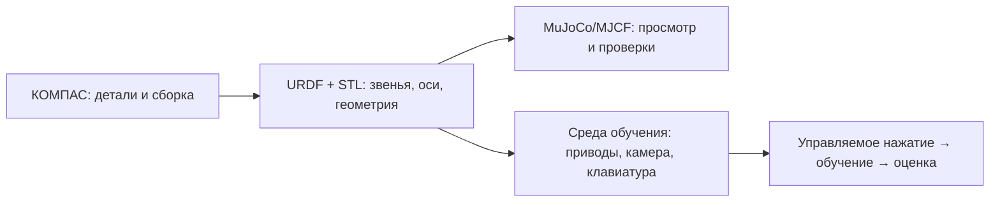

# От сборки в КОМПАСе к виртуальной руке

CAD-сборка отвечает на вопрос «из чего и как собрана рука». Симулятору дополнительно нужны однозначные сведения: какие части движутся вместе, вокруг какой оси вращается каждый сустав, где находятся камера и рабочая кромка, как взаимодействуют поверхности и чем создаётся движение. Это передают стандартные описания робота и среды.

## URDF: описание конструкции для робототехнических программ

**URDF = Unified Robot Description Format**. Это обычный текстовый XML-файл, который можно открыть в редакторе. Он ссылается на файлы геометрии и описывает дерево звеньев (`link`) и соединений (`joint`). Наша текущая версия — [eb300_jaw_typing_r8.urdf](../robohand_ws/src/robohand_description/urdf/eb300_jaw_typing_r8.urdf).

**Звено** — жёсткая часть или группа деталей, которые в выбранной модели не двигаются друг относительно друга. Несколько корпусов, труба и крепёж могут образовывать одно звено. Шестерёнки внутри редуктора для первого описания не требуется моделировать по отдельности.

**Сустав** задаёт связь родительского и дочернего звеньев: точку/ориентацию соединения, ось, тип и ограничения движения. Вращательный сустав обозначается `revolute`; неподвижное соединение — `fixed`. У EB300 шесть вращательных суставов J1–J6. Дополнительные неподвижные звенья нужны для камеры, телефона, захвата и рабочей точки, поэтому число XML links больше числа подвижных узлов.

Упрощённый фрагмент по нашему J1:

```xml
<joint name="J1" type="revolute">
  <parent link="base_link"/>
  <child link="shoulder_link"/>
  <origin xyz="0 0 0.037" rpy="0 0 0"/>
  <axis xyz="0 0 1"/>
  <limit lower="-0.08726646" upper="0.08726646"
         effort="5" velocity="0.08726646"/>
</joint>
```

Это значит: плечо соединено с основанием; точка соединения находится на 37 мм выше начала координат основания; вращение идёт вокруг местной оси Z. Координаты записаны в метрах, углы — в радианах. Числа ±0,08726646 соответствуют ±5° — **нынешнему проверочному диапазону**, а не измеренным механическим пределам EB300. Effort/velocity здесь также номинальные ограничения для проверки. `q=0` соответствует принятой CAD-позе; это ещё не аппаратный ноль концевика/энкодера.

В каждом физическом звене также описываются:

| Данные | Для чего нужны |
|---|---|
| `visual` | Видимая форма: наши STL, цвет и положение относительно звена |
| `collision` | Геометрия для расчёта столкновений; для ряда деталей она упрощена |
| `inertial` | Масса, центр масс и инерция, необходимые для динамики |
| Системы координат | Где расположены звено, камера и рабочая точка губки |

STL хранит треугольники поверхности. Сам по себе он не сообщает симулятору, где ось сустава, какой допустим угол и какой двигатель установлен.

## Как сделали описание именно нашей EB300

1. В КОМПАСе проверили состав сборки, жёсткие группы, положения и оси компонентов; результаты чтения CAD сохранили в отчётах.
2. Геометрию звеньев и оснастки представили meshes; построили стандартное дерево звеньев J1–J6 и неподвижных креплений. Точка контакта взята с реальной вершины штатной губки.
3. Положения звеньев и систем координат перенесли в стандартные поля URDF. Это подготовка данных по CAD; универсальный автоматический exporter из всех сопряжений КОМПАСа не создавался.
4. Добавили оценочные массы, инерции и небольшие диапазоны проверки. Известная масса Redmi 8A — 188 г; остальные физические параметры в основном требуют измерений.
5. Проверили синтаксис/дерево `check_urdf`, сборку description ROS 2, импорт в MuJoCo и соответствие поз CAD/robot description. [Независимая приёмка R8](cad-reviews/2026-11-15-logical-r8/root-acceptance.json).

URDF даёт описание конструкции. Для работающего управления остаются нужны привод/контроллер, реальные ограничения, настройки камеры и условия конкретной задачи.

## MuJoCo и MJCF: что это за сцена

**MuJoCo** — физический движок и набор средств просмотра. Он вычисляет движение тел и контакты по модели. На текущем Windows ПК он уже установлен и запускается отдельно от Docker. Его штатный формат сцены — **MJCF**, тоже XML. URDF можно загрузить штатным импортёром MuJoCo и сохранить в MJCF. [Официальное описание форматов](https://mujoco.readthedocs.io/en/stable/modeling.html).

Наша [inspection scene](../robohand_ws/src/robohand_description/urdf/eb300_jaw_typing_r8.validation.xml) содержит импортированную EB300, meshes, физические параметры, номинальную камеру на запястье, освещение и условную плоскость. В ней шесть координат суставов, **ноль приводов**, гравитация `0 0 0`. Поэтому она предназначена для осмотра и проверки модели. Неподвижность руки в этом режиме не доказывает, что настоящие двигатели удержат её вес.

Клавиатуры с движущимися клавишами, управления нажатием и нейросети в этой сцене пока нет. Их добавляет следующий этап готовой task environment, а не сам факт наличия URDF.



Просмотр в MuJoCo не заменяет проверку NVIDIA/Isaac Lab/Newton/RTX. Это разные этапы совместимости.

## Ручное управление перед обучением

Ручная проверка полезна: сначала оператор сам пробует позы, оценивает доступность клавиатуры и обзор камеры. Для этого обучение не требуется.

**Сейчас:** открыть штатный MuJoCo viewer по [инструкции](start-here-r8.md), поставить симуляцию на паузу и использовать панель **Joint**. В штатном viewer `Space` включает/выключает ход симуляции, `Alt+J` раскрывает/сворачивает Joint; ползунки меняют положения суставов в заданных диапазонах. Это изменение позы, а не проверка физического сервопривода. [Официальное управление viewer](https://mujoco.readthedocs.io/en/stable/programming/samples.html#simulate).

**После подключения виртуальных приводов:** ручной режим должен отправлять команды контроллеру и позволять отпусканием ввода остановить движение. Затем уже проверяем одно нажатие клавиши. Геймпад можно добавить на этом этапе; отдельно покупать его для первого просмотра не нужно.

Есть два разных режима пульта: выбирать сустав и менять его угол либо двигать рабочую точку «влево/вправо/вверх/вниз». Второй требует обратной кинематики, которая переводит движение рабочей точки в согласованные углы шести суставов. Геймпад сам эту задачу не решает.

Готовые пути и ограничения выбранных версий разобраны в [исследовании ручного управления](research/2026-11-15-manual-control-and-typing-hooks.md). Новый UI/драйвер пульта сейчас не пишем. Ручная проверка полезна для PPO, но записанный оператором показ сам по себе не является обучением ACT: это другой метод и отдельный датасетный сценарий.

[Индекс](index.md) · [Текущие файлы](latest-artifacts.md).
